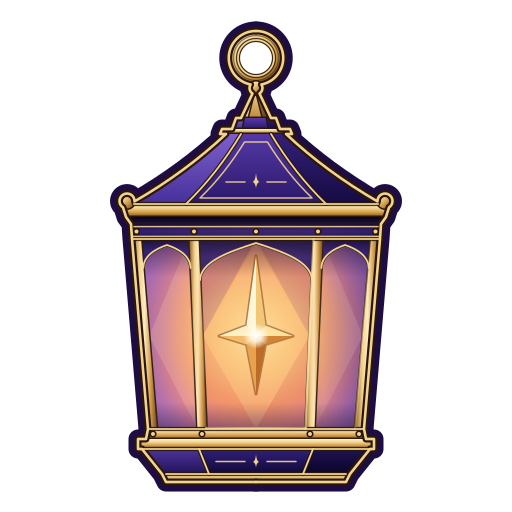
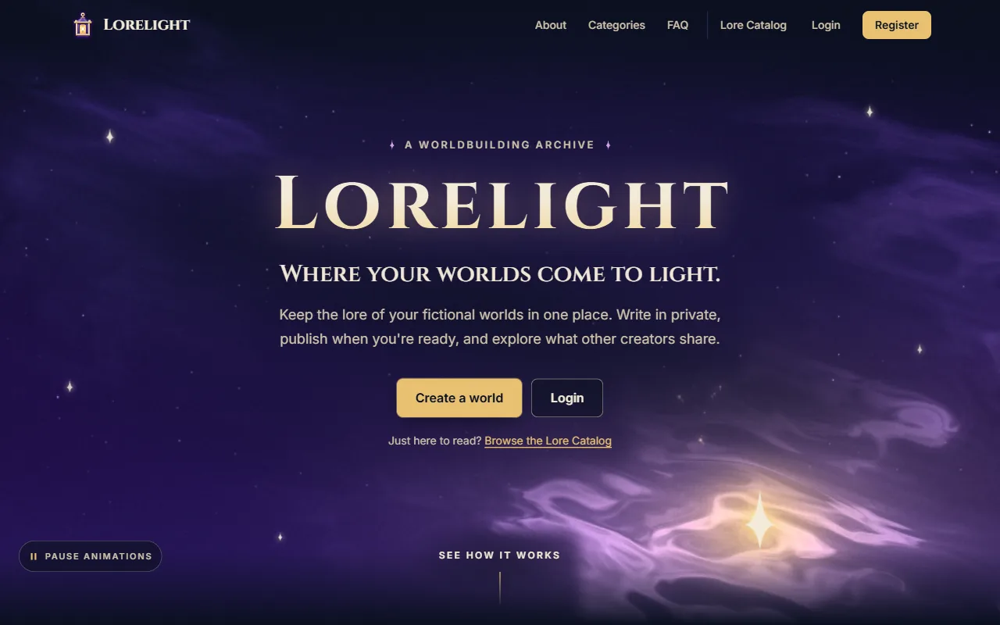
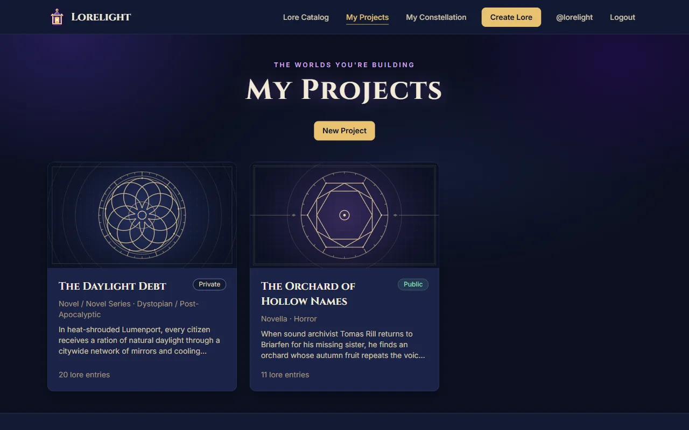
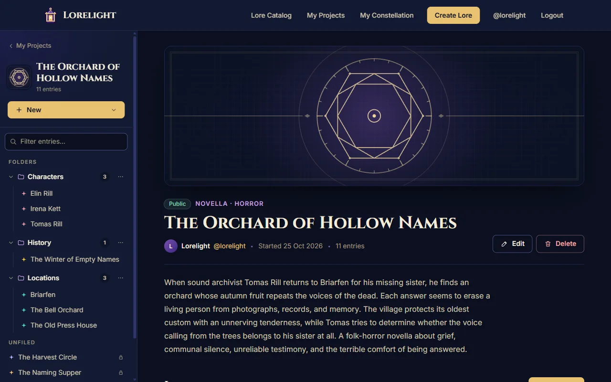
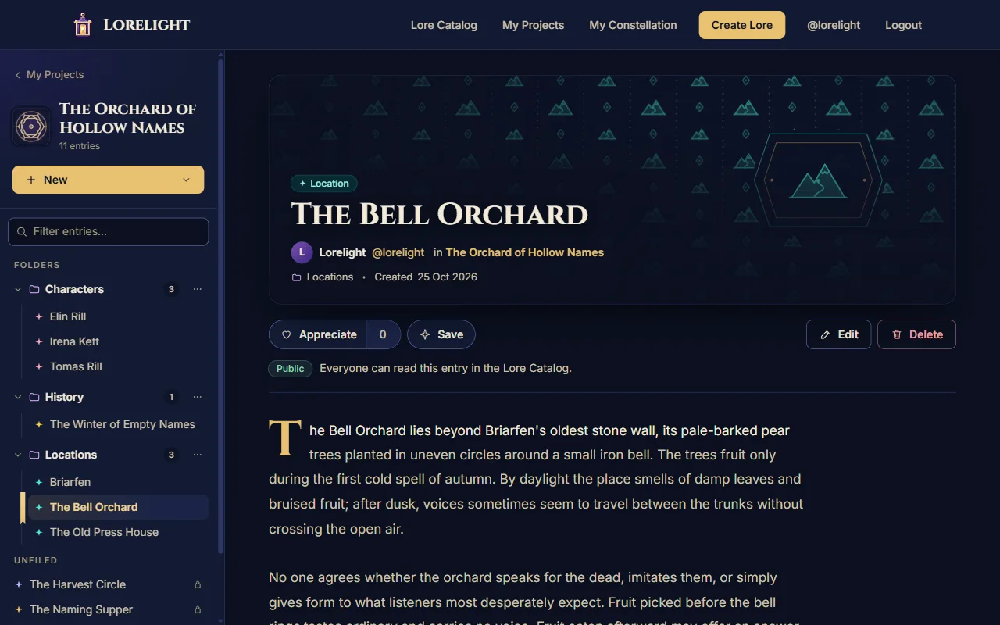
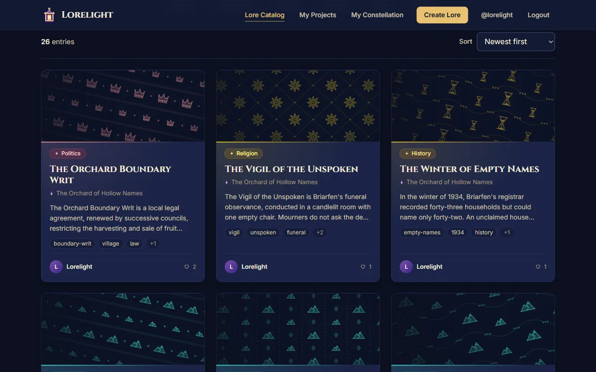
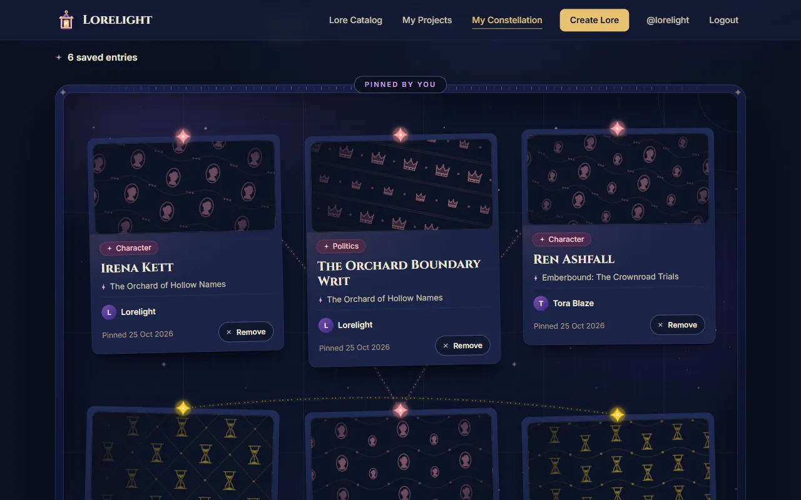
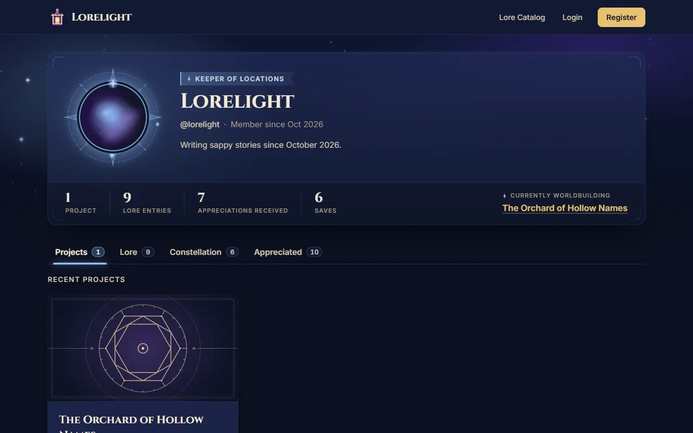
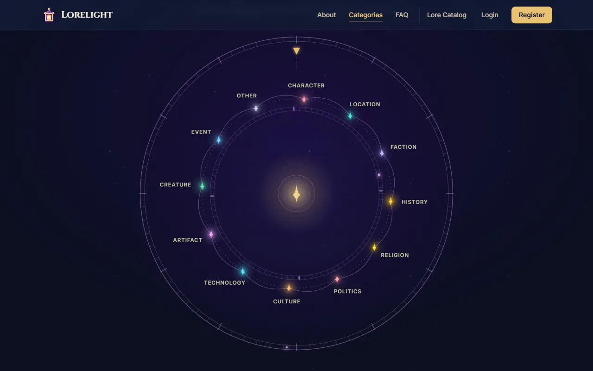

<p align="center">
  
</p>

<h1 align="center">Lorelight</h1>

<p align="center"><sub>✦ &nbsp; A &nbsp; W O R L D B U I L D I N G &nbsp; A R C H I V E &nbsp; ✦</sub></p>

> *Every world begins as scattered notes: a name in a margin, a map on the back of a receipt, a war remembered in a single line. Lorelight is the lantern you carry through them.*

<p align="center">
  <a href="https://lorelight.vercel.app"></a>
</p>

<p align="center">
  
  
  
  
  
  
  <a href="LICENSE"></a>
</p>



## ✦ I · Kindle a World

Every world begins as a **Project**. Name it, choose its format (a novel, a tabletop campaign, a video game…) and its genre, and give it a cover, or let Lorelight engrave a sigil for it. Folders keep its lore in order as it grows.

## ✦ II · Write Its Lore

Characters, places, factions, relics, creatures, wars: every **Lore Entry** belongs to one of twelve categories, each with its own colour and emblem. Tag it, link a picture (or let its category's emblem stand in), and file it in a folder.

## ✦ III · Share It When It's Ready

Nothing leaves your desk until you say so. New worlds and entries start private, and an entry steps into the light only when both the entry and its Project are public. If it goes private again, it quietly leaves every Constellation.

## ✦ IV · Wander the Catalog

Public lore from every world gathers in the **Lore Catalog**. Search by title, text or tag, follow a single category, sort by newest or oldest, and see what other creators are dreaming up. Anyone can wander in; appreciating, saving and writing need an account.

## ✦ V · Gather a Constellation

Appreciate the entries you love and pin them to your **Constellation**, a board where threads of stardust join lore of the same kind.

## ✦ VI · Meet the Creators

Every creator has a profile: a framed avatar, a star colour of their choosing, a title earned from the lore they write most, and tabs for everything they've shared.

## ✦ A Glimpse Inside

<table>
  <tr>
    <td width="50%"><br><sub><b>My Projects</b> · every world, with engraved covers</sub></td>
    <td width="50%"><br><sub><b>Project workspace</b> · folders and entries in the sidebar</sub></td>
  </tr>
  <tr>
    <td><br><sub><b>Lore Details</b> · an entry with its world beside it</sub></td>
    <td><br><sub><b>Lore Catalog</b> · public lore from every world</sub></td>
  </tr>
  <tr>
    <td><br><sub><b>My Constellation</b> · saved lore, joined by category</sub></td>
    <td><br><sub><b>Creator Profile</b> · title, stats and star colour</sub></td>
  </tr>
</table>

---

## ✦ Light Your Own Lantern

The quickest way to explore Lorelight is the [live app](https://lorelight.vercel.app). To run your own copy on your computer, follow these steps.

### Prerequisites

- Node.js 22.22 or newer
- npm
- Your own Supabase project (a free one is enough). This repository doesn't include any keys.

### Installation

1. Clone the repository

   ```bash
   git clone https://github.com/JStanoeva/lorelight.git
   cd lorelight
   ```

2. Install packages

   ```bash
   npm install
   ```

3. Create a `.env.local` file in the project root (copy `.env.example` and fill in your own values)

   ```env
   VITE_SUPABASE_URL=your-supabase-project-url
   VITE_SUPABASE_ANON_KEY=your-supabase-anon-key
   ```

   Copy the Project URL and the anon (or publishable) key from your Supabase dashboard. The app doesn't start without this file.

4. Set up your Supabase project

   - In the Supabase SQL Editor, run the 7 files in `supabase/migrations/` one after another, from `001` to `007`. They create the whole database: tables, rules, triggers, security policies and the image storage bucket.
   - In the Authentication settings, open the Email sign-in provider and turn off **Confirm email**, so new accounts are logged in right after registering.
   - Create accounts through the app's Register page. Accounts can't be added from the Supabase dashboard, because every profile needs a username.
   - A new database starts empty, so add your own projects and lore through the app.

5. Start the development server

   ```bash
   npm run dev
   ```

   The app runs at `http://localhost:5173`.

### Available Scripts

| Command           | Description                             |
| ----------------- | --------------------------------------- |
| `npm run dev`     | Starts the development server           |
| `npm run build`   | Creates the production build in `dist/` |
| `npm run preview` | Serves the production build locally     |
| `npm run lint`    | Checks the code with ESLint             |
| `npm test`        | Runs the unit tests once with Vitest    |

---

## ✦ How the Archive Is Built

For the curious, here's what holds the lanterns up.

### Tech Stack

- **Frontend:** React 19, JavaScript, Vite, React Router 8 (declarative routes in `App.jsx`)
- **Styling:** Tailwind CSS 4 and external CSS files
- **Backend:** Supabase (PostgreSQL, Auth, Row Level Security), used through the Supabase JavaScript client
- **Deployment:** Vercel (frontend), Supabase (backend)
- **Testing:** Vitest (unit tests for the validation rules and other helper functions)

### Folder Structure

The code is organized by feature: each feature folder holds the code for one part of the app.

```
src/
├── app/            # App.jsx (all routes, wrapped in AuthProvider), layout (header, footer), Home and Not Found pages
├── features/
│   ├── auth/           # AuthContext, route guards, Login and Register, auth service
│   ├── home/           # Home page sections and their animations (no data)
│   ├── lore/           # catalog, details, lore forms, lore service
│   ├── projects/       # project pages, sidebar, folders, project service
│   ├── constellation/  # Save button and My Constellation
│   ├── appreciation/   # Appreciate button, hook and service
│   └── profile/        # Creator Profile and Edit Profile
├── shared/         # shared components, hooks, utilities, constants and styles
├── lib/            # Supabase client
├── styles/         # shared component classes (components.css)
├── index.css       # Tailwind, theme colours and fonts, base styles
└── main.jsx        # entry point
```

A feature folder can have:

- `pages/`: routed pages
- `components/`: UI pieces
- `hooks/`: React logic and data loading
- `services/`: all Supabase calls
- `context/`: React Context (in `auth` and `home`)
- `guards/`: route guards (in `auth`)
- `styles/`: the feature's CSS files
- `shaders/`: the code that draws the Home page's animated sky (in `home`)
- `utils/`, `constants/`: helpers and fixed values

Unit tests sit next to the file they test and end in `.test.js` (for example `src/features/lore/utils/tags.test.js`). They check plain helper functions, such as the validation rules, without a browser or Supabase.

`lore/` is its own feature next to `projects/` because lore also appears in the catalog, the Constellation and profiles. `shared/` never imports from `features/`.

### Data Flow

```
Page (or its layout route) → custom hook → service → Supabase
```

Example: `/lore/:entryId` → `ProjectWorkspaceLayout` (the layout route around `LoreDetailsPage`) → `useLoreEntry(entryId)` → `loreService.getLoreById()` → Supabase. `LoreDetailsPage` then gets the entry through `useOutletContext()`.

Changes skip the hook: the page or component calls the service directly (for example `CreateLorePage` → `loreService.createLore()` → Supabase).

Services contain no React code, and pages contain no Supabase code.

### Data Model

| Table                 | Purpose                                                                                             |
| --------------------- | --------------------------------------------------------------------------------------------------- |
| `profiles`            | Public user info (unique username, display name, bio, avatar link, star colour), created on sign-up |
| `projects`            | Collections of lore owned by a user, each with a format and an optional genre                       |
| `lore_folders`        | Optional folders that organize the lore inside one project (one level)                              |
| `lore_entries`        | Main content; every entry belongs to exactly one project, and optionally to one of its folders      |
| `appreciations`       | One row per user per appreciated entry                                                              |
| `constellation_saves` | One row per user per saved entry                                                                    |

All ids are UUIDs (a profile uses its user's id from Supabase Auth). Pictures (project covers, lore images and avatars) are saved as links. The database also has a storage bucket (`images`) ready for image uploads, which are planned for a later version.

### Security

The database enforces the rules itself (Row Level Security policies, column privileges, foreign keys and triggers), not only the UI:

- A Lore Entry is public only when both the entry and its Project are public. Owners can also read their own private rows.
- Only the owner can create, change or delete their lore, Projects and folders, and users can change only their own profile. Lore can only go into the author's own Projects, and only into a folder of its own Project.
- Other users see a folder only while it holds public lore.
- Users can add appreciations and saves only for public lore, and can add or remove only their own.
- Saved lore that becomes private is removed from every Constellation automatically.
- Guests can only read, and nobody can change ids, owners, usernames or dates through the API.

The database tables, rules, triggers and policies are stored as numbered SQL files in `supabase/migrations/`.

---

<p align="center">
  <br>
  <sub><i>Twelve stars, one for every kind of lore.</i></sub>
</p>

<p align="center"><sub>✦ &nbsp; Made by <a href="https://github.com/JStanoeva">JStanoeva</a> &nbsp;·&nbsp; <a href="LICENSE">MIT License</a> &nbsp; ✦</sub></p>
